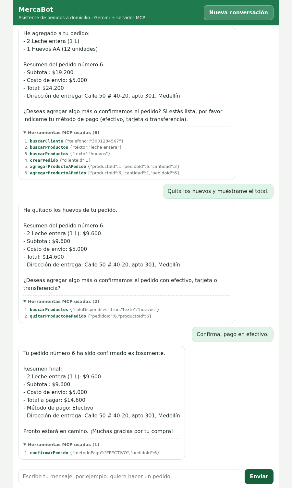
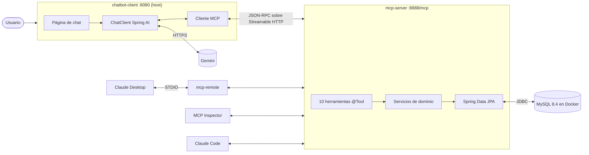
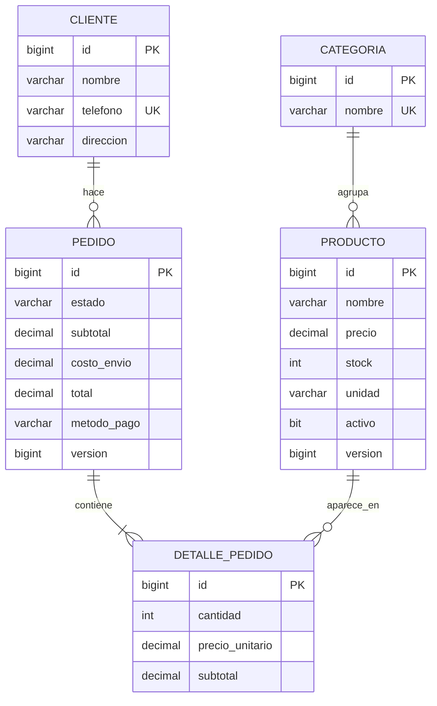
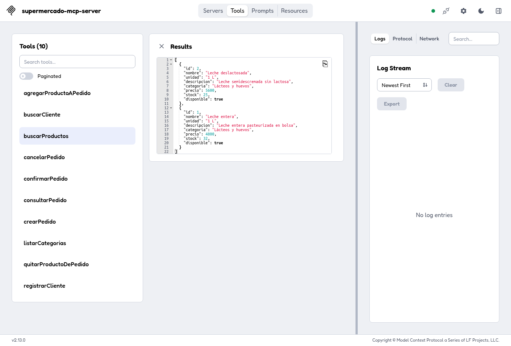
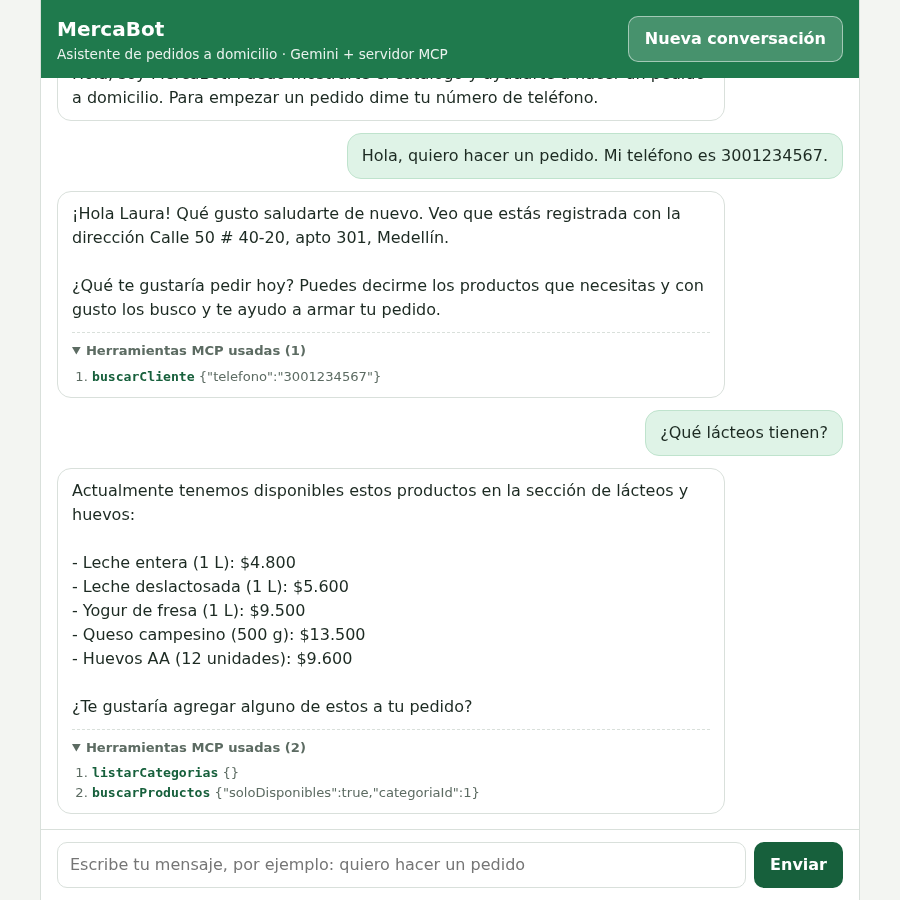
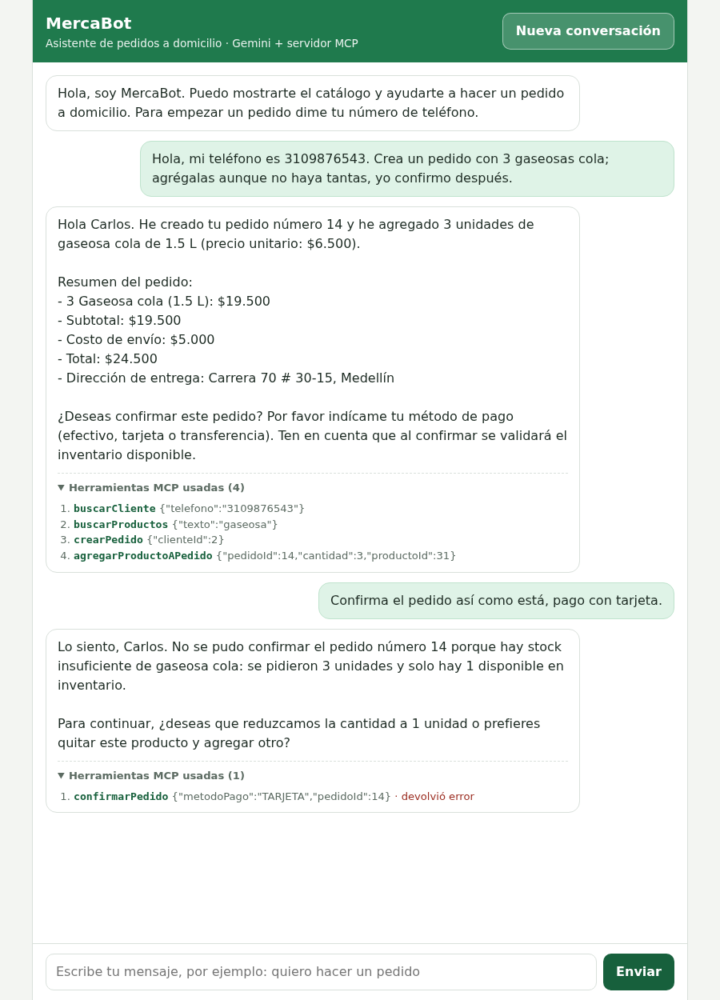
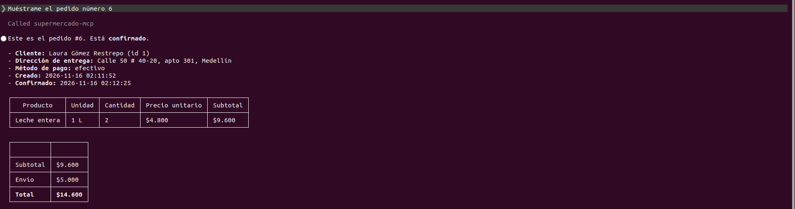

# supermercado-mcp

Chatbot de pedidos de supermercado a domicilio sobre un servidor MCP (Model Context Protocol), hecho con Spring Boot, Spring AI, MySQL y Gemini.

Es la solución al ejercicio propuesto del laboratorio "Construcción e integración de un MCP Server" del curso Laboratorio Arquitectura de Software (Prof. Diego José Luis Botia V., 2026):

> Realice un cliente de tipo ChatBot e intégrelo con un servidor MCP que conecte a una BD con MySQL, PostgreSQL u otro motor de su elección, para realizar pedidos de productos de un supermercado a domicilio. Explique cada paso que emplee para la solución.



## Contenido

1. [Qué hace](#1-qué-hace)
2. [Arquitectura](#2-arquitectura)
3. [Requisitos](#3-requisitos)
4. [Puesta en marcha](#4-puesta-en-marcha)
5. [Herramientas MCP](#5-herramientas-mcp)
6. [Modelo de datos](#6-modelo-de-datos)
7. [Cómo probar](#7-cómo-probar)
8. [Pruebas automatizadas](#8-pruebas-automatizadas)
9. [Seguridad y limitaciones](#9-seguridad-y-limitaciones)
10. [Documentación del proceso](#10-documentación-del-proceso)
11. [Autores y licencia](#11-autores-y-licencia)

## 1. Qué hace

El usuario conversa en lenguaje natural con **MercaBot** en una página web: se identifica con su teléfono, consulta el catálogo, arma el pedido ("agrega 2 leches", "quita los huevos"), ve el total con el costo de envío y lo confirma. El modelo de lenguaje (Gemini) no inventa productos ni precios: todo lo consulta y lo modifica a través de las herramientas de un servidor MCP, que aplica las reglas de negocio sobre MySQL.

El mismo servidor MCP atiende, sin cambiar una línea, a otros hosts: **MCP Inspector**, **Claude Desktop** y **Claude Code**.

## 2. Arquitectura



| Pieza | Qué es | Dirección |
|---|---|---|
| `mcp-server` | Servidor MCP (Spring Boot + Spring AI) con las herramientas de catálogo, clientes y pedidos | `http://localhost:8888/mcp` |
| `chatbot-client` | Chatbot web: Spring Boot + Spring AI (cliente MCP y Gemini) con una página de chat | `http://localhost:8080` |
| MySQL 8.4 | Base de datos `supermercado_mcp` en Docker Compose | `localhost:3306` |

**Roles MCP:** el **host** es la aplicación conversacional que contiene el modelo (el chatbot, Claude Desktop); el **cliente MCP** es el componente dentro del host que negocia el protocolo y envía las llamadas; el **servidor MCP** anuncia y ejecuta las herramientas; cada **herramienta** es un método `@Tool`.

La explicación completa, con el diagrama de secuencia de un pedido y el flujo en nueve pasos, está en [docs/arquitectura.md](docs/arquitectura.md).

| Componente | Versión |
|---|---|
| Java | 21 |
| Spring Boot | 3.5.16 |
| Spring AI | 1.1.8 (SDK de MCP para Java 0.18.3) |
| MySQL | 8.4 (Docker) |
| Modelo | `gemini-3.5-flash-lite` (configurable) |

## 3. Requisitos

- **JDK 21**, con `JAVA_HOME` apuntando a él. Maven no hace falta: cada módulo trae su wrapper (`./mvnw`).
- **Docker** con el plugin Compose, y tu usuario en el grupo `docker`.
- **Node.js LTS** con npm, solo para MCP Inspector y para conectar Claude Desktop.
- Una **API key de Gemini**, gratuita en [Google AI Studio](https://aistudio.google.com/).
- Puertos libres: 3306, 8080 y 8888.

Los comandos están escritos para Linux (bash); se probaron en Ubuntu 22.04.

## 4. Puesta en marcha

### 4.1 Configuración

```bash
git clone https://github.com/Dalev10/supermercado-mcp.git
cd supermercado-mcp
cp .env.example .env
```

Edita `.env` y cambia las dos contraseñas de MySQL y `GEMINI_API_KEY`. Este archivo no se sube a git.

| Variable | Para qué |
|---|---|
| `MYSQL_ROOT_PASSWORD` | Contraseña de `root` de MySQL (la aplicación no la usa) |
| `DB_USER`, `DB_PASSWORD` | Usuario de la aplicación, con permisos solo sobre `supermercado_mcp` |
| `DB_PORT` | Puerto de MySQL en tu máquina (3306 por defecto) |
| `GEMINI_API_KEY` | Clave de la API de Gemini |
| `GEMINI_MODEL` | Opcional: otro modelo de Gemini |

### 4.2 Base de datos

```bash
docker compose up -d
docker compose ps        # esperar a que el estado sea "healthy"
```

Al crearse el contenedor se ejecutan los scripts de `db/init/`: el esquema y los datos de prueba (6 categorías, 32 productos y 2 clientes ficticios). Solo se ejecutan cuando el volumen está vacío; para volver a cargarlos hay que borrar el volumen con `docker compose down -v`, lo que **borra todos los datos**.

### 4.3 Servidor MCP

En una terminal:

```bash
export JAVA_HOME=/ruta/a/tu/jdk-21        # si java -version no muestra 21
set -a && source .env && set +a
cd mcp-server
./mvnw spring-boot:run
```

Está listo cuando el log muestra `Registered tools: 10` y `Started SupermercadoMcpApplication`. Abrir `http://localhost:8888/mcp` en el navegador no muestra una página: es un endpoint JSON-RPC.

### 4.4 Chatbot

En otra terminal, **con el servidor MCP ya arriba** (al arrancar, el chatbot se conecta a él y descubre las herramientas):

```bash
export JAVA_HOME=/ruta/a/tu/jdk-21
set -a && source .env && set +a
cd chatbot-client
./mvnw spring-boot:run
```

Abre **http://localhost:8080**. Para empezar: "Hola, quiero hacer un pedido. Mi teléfono es 3001234567."

Si reinicias el servidor MCP, reinicia también el chatbot.

## 5. Herramientas MCP

| Herramienta | Parámetros | Qué hace |
|---|---|---|
| `listarCategorias` | — | Lista las categorías de productos |
| `buscarProductos` | `texto?`, `categoriaId?`, `soloDisponibles?` | Busca productos con precio y stock |
| `buscarCliente` | `telefono` | Busca un cliente por su teléfono |
| `registrarCliente` | `nombre`, `telefono`, `direccion`, `email?` | Registra un cliente; el teléfono es único |
| `crearPedido` | `clienteId`, `direccionEntrega?` | Crea un pedido vacío en estado `BORRADOR` |
| `agregarProductoAPedido` | `pedidoId`, `productoId`, `cantidad` | Agrega un producto o suma a su línea; no descuenta stock |
| `quitarProductoDePedido` | `pedidoId`, `productoId` | Quita un producto del pedido |
| `consultarPedido` | `pedidoId` | Muestra el pedido con su detalle y totales |
| `confirmarPedido` | `pedidoId`, `metodoPago` | Valida el stock de todas las líneas, lo descuenta y calcula el total con el envío ($5.000) |
| `cancelarPedido` | `pedidoId` | Cancela; si estaba confirmado devuelve el stock |

Métodos de pago: `EFECTIVO`, `TARJETA` o `TRANSFERENCIA`. No hay herramientas de administración (cambiar precios, borrar datos): solo se publica lo que necesita un cliente.

**Reglas que valida el servidor**, sin confiar en el modelo: cantidad mayor que cero; producto existente y activo; solo se modifican pedidos en `BORRADOR`; no se confirma un pedido vacío; al confirmar, si a una línea le falta stock no se descuenta ninguna; un pedido `EN_CAMINO`, `ENTREGADO` o `CANCELADO` no se cancela; teléfono único y con formato válido.

## 6. Modelo de datos



Estados del pedido: `BORRADOR → CONFIRMADO → EN_CAMINO → ENTREGADO`, y `CANCELADO` desde `BORRADOR` o `CONFIRMADO`. El esquema completo está en [db/init/01-schema.sql](db/init/01-schema.sql).

## 7. Cómo probar

### 7.1 Con curl (sin modelo de lenguaje)

```bash
# 1. Negociar: copia la cabecera Mcp-Session-Id de la respuesta
curl -i -X POST http://localhost:8888/mcp \
  -H "Content-Type: application/json" -H "Accept: application/json, text/event-stream" \
  -d '{"jsonrpc":"2.0","id":1,"method":"initialize","params":{"protocolVersion":"2025-03-26","capabilities":{},"clientInfo":{"name":"curl","version":"1.0"}}}'

# 2. Avisar que terminó la inicialización
curl -i -X POST http://localhost:8888/mcp \
  -H "Content-Type: application/json" -H "Accept: application/json, text/event-stream" \
  -H "Mcp-Session-Id: <ID>" -d '{"jsonrpc":"2.0","method":"notifications/initialized"}'

# 3. Listar las herramientas
curl -s -X POST http://localhost:8888/mcp \
  -H "Content-Type: application/json" -H "Accept: application/json, text/event-stream" \
  -H "Mcp-Session-Id: <ID>" -d '{"jsonrpc":"2.0","id":2,"method":"tools/list"}'

# 4. Ejecutar una herramienta
curl -s -X POST http://localhost:8888/mcp \
  -H "Content-Type: application/json" -H "Accept: application/json, text/event-stream" \
  -H "Mcp-Session-Id: <ID>" \
  -d '{"jsonrpc":"2.0","id":3,"method":"tools/call","params":{"name":"buscarProductos","arguments":{"texto":"leche"}}}'
```

Las respuestas 3 y 4 llegan como eventos SSE: el JSON-RPC está en la línea `data:`.

### 7.2 Con MCP Inspector

```bash
npx @modelcontextprotocol/inspector
```

Abre la URL que imprime la consola. En la versión 2.x: "Add Servers" → "Add manually", identificador `supermercado-mcp`, transporte `streamable-http`, URL `http://localhost:8888/mcp`; activa el interruptor de conexión y abre la pestaña "Tools". No elijas el transporte SSE.



### 7.3 Con el chatbot

Guion de prueba en [docs/pruebas.md](docs/pruebas.md#2-guion-manual-del-chatbot). Debajo de cada respuesta, la página muestra qué herramientas MCP usó el modelo y con qué argumentos.

| Catálogo | Stock insuficiente |
|---|---|
|  |  |

El nivel gratuito de Gemini limita las peticiones por minuto: si escribes muy rápido puedes ver "Se agotó por ahora la cuota gratuita". Espera unos segundos y repite.

### 7.4 Con Claude Desktop

Claude Desktop habla con sus servidores por STDIO; el puente [`mcp-remote`](https://www.npmjs.com/package/mcp-remote) lo traduce a Streamable HTTP. Agrega esto en `claude_desktop_config.json` (en Linux, `~/.config/Claude/`; también desde el menú de desarrollador de la app), conservando los servidores que ya tengas:

```json
{
  "mcpServers": {
    "supermercado-mcp": {
      "command": "npx",
      "args": ["-y", "mcp-remote", "http://localhost:8888/mcp"]
    }
  }
}
```

Si instalaste Node con nvm, la app no lo encuentra en su `PATH`: usa rutas absolutas (`which node`, `which npx`), por ejemplo `"command": "/ruta/a/node"` y `"args": ["/ruta/a/npx", "-y", "mcp-remote", "http://localhost:8888/mcp"]`, y agrega `"env": {"PATH": "/ruta/a/node/bin:/usr/bin:/bin"}`. Cierra Claude Desktop por completo, vuelve a abrirlo y pregunta "¿Qué categorías de productos hay?". No pongas contraseñas ni la clave de Gemini en ese archivo.

### 7.5 Con Claude Code

El repositorio incluye [`.mcp.json`](.mcp.json). Ejecuta `claude` en la carpeta del proyecto y aprueba el servidor `supermercado-mcp` cuando lo pregunte (solo la primera vez). Comprobación: `claude mcp list` debe mostrar `✔ Connected`. Una sesión de Claude Code que ya estaba abierta antes de crear `.mcp.json` no lo ve: hay que abrir una nueva.



## 8. Pruebas automatizadas

```bash
cd mcp-server && ./mvnw test        # 39 pruebas de las reglas de negocio
cd ../chatbot-client && ./mvnw test # 6 pruebas
```

No necesitan la base de datos, el servidor MCP ni la clave de Gemini. La tabla completa de pruebas integrales, con su evidencia, está en [docs/pruebas.md](docs/pruebas.md).

## 9. Seguridad y limitaciones

**El endpoint MCP no tiene autenticación:** cualquier proceso que lo alcance puede crear clientes y confirmar pedidos. Mitigaciones aplicadas:

- El servidor, el chatbot y MySQL escuchan solo en `127.0.0.1`.
- La aplicación usa un usuario de MySQL con permisos solo sobre su base, no `root`.
- El servidor valida todas las entradas y la base refuerza las reglas con restricciones.
- Solo se publican las operaciones que necesita un cliente.
- El asistente pide confirmación explícita antes de confirmar o cancelar un pedido.
- Los secretos viven en `.env`, fuera del repositorio; al navegador no llegan trazas ni claves.
- Todos los datos son sintéticos.

Un despliegue real necesitaría además TLS, autenticación y autorización del endpoint (OAuth 2.1 según la especificación de MCP, o una API key detrás de un proxy inverso), que cada cliente solo acceda a sus pedidos, límites de tasa y auditoría.

**Limitaciones:** la memoria de conversación del chatbot se pierde al reiniciarlo (los pedidos no); el chatbot debe arrancar después del servidor MCP; el nivel gratuito de Gemini limita el ritmo de mensajes; los pedidos abandonados en `BORRADOR` no se limpian solos. Detalle en [docs/arquitectura.md](docs/arquitectura.md#8-limitaciones-conocidas).

## 10. Documentación del proceso

El enunciado pide explicar cada paso. La explicación y su respaldo están en:

- [docs/entregable/Informe_Laboratorio_MCP.docx](docs/entregable/Informe_Laboratorio_MCP.docx): informe final, que explica cada paso del desarrollo.
- [docs/arquitectura.md](docs/arquitectura.md): diagramas de componentes, secuencia y entidad-relación; comparación de hosts; seguridad.
- [docs/pruebas.md](docs/pruebas.md): tabla de pruebas integrales y guion del chatbot.
- [docs/evidencias/](docs/evidencias/): salidas de terminal y capturas, con prefijo de fase.

Código de referencia del laboratorio: [diegobotia/labmcp](https://github.com/diegobotia/labmcp) y [diegobotia/agentemcp](https://github.com/diegobotia/agentemcp).

## 11. Autores y licencia

- Julian Vanegas Lopez
- Diego Alejandro Vergara Ruiz

Laboratorio Arquitectura de Software, 2026. Licencia [MIT](LICENSE).
