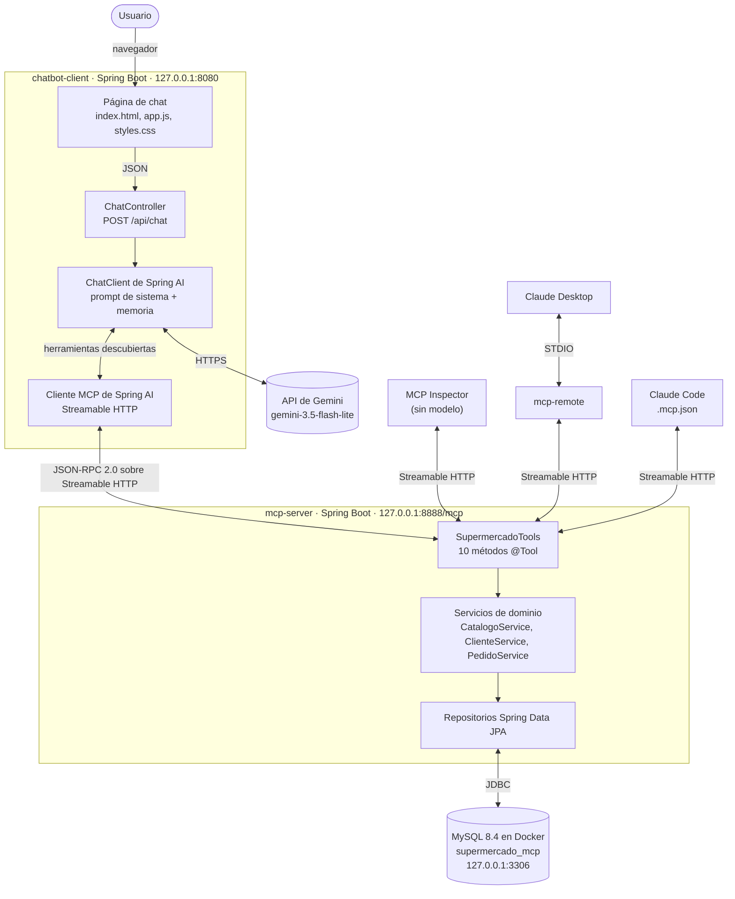
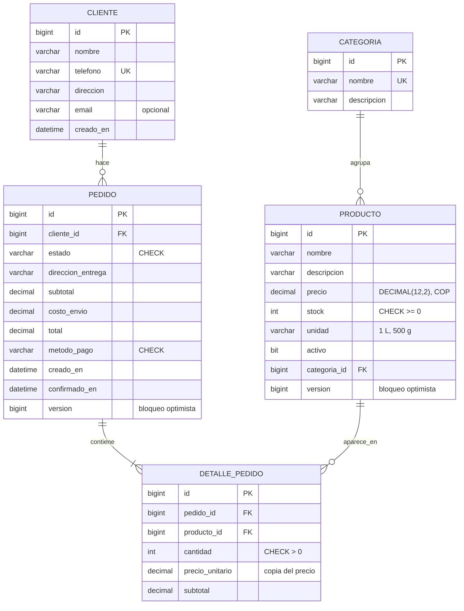
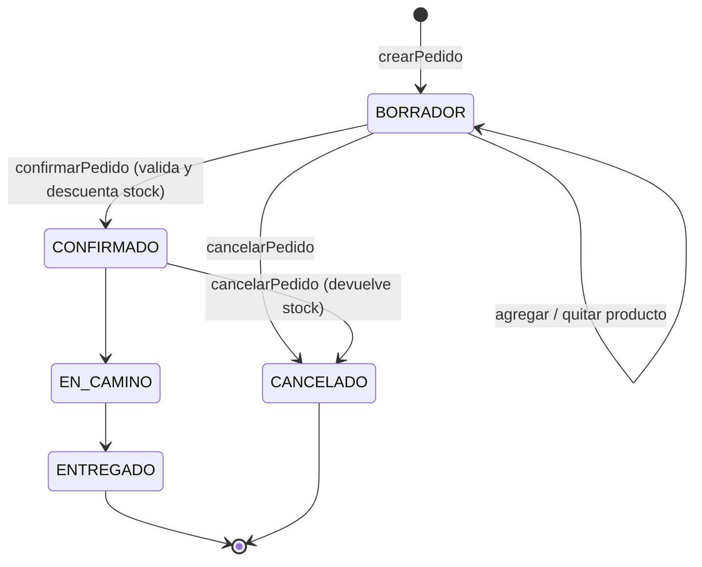
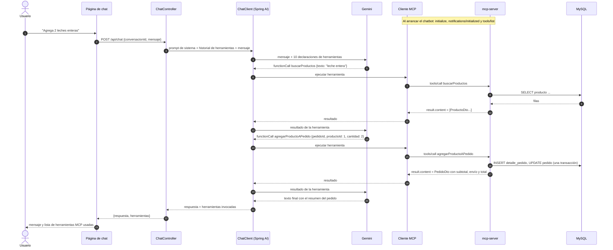

# Arquitectura

Este documento explica cómo está construido `supermercado-mcp` y cómo viaja un pedido desde el chat hasta la base de datos. Para ponerlo en marcha, ver el [README](../README.md).

## 1. Roles MCP

El Model Context Protocol (MCP) separa cuatro papeles. En este proyecto quedan así:

| Rol | Qué hace | En este proyecto |
|---|---|---|
| **Host** | Aplicación conversacional que contiene el modelo de lenguaje | `chatbot-client` (con Gemini), Claude Desktop (con Claude), Claude Code |
| **Cliente MCP** | Componente dentro del host que negocia el protocolo, descubre herramientas y envía las llamadas | Spring AI MCP Client en el chatbot; `mcp-remote` como puente en Claude Desktop; MCP Inspector cuando se prueba sin modelo |
| **Servidor MCP** | Anuncia las herramientas y las ejecuta | `mcp-server` (Spring Boot + Spring AI) en `http://localhost:8888/mcp` |
| **Herramienta** | Operación concreta que el modelo puede invocar | Cada método `@Tool` de `SupermercadoTools` (10 en total) |

El modelo nunca toca la base de datos: decide qué herramienta llamar y con qué argumentos, y el servidor la ejecuta aplicando sus propias reglas.

## 2. Componentes

**Decisiones de diseño que se ven en el diagrama:**

- **Capas en el servidor.** `SupermercadoTools` es un adaptador delgado: recibe la llamada MCP y delega. Las reglas de negocio y las transacciones viven en los servicios, que se prueban sin protocolo ni base de datos (39 pruebas unitarias). Las herramientas devuelven DTO (`record`) y no entidades JPA, para controlar exactamente lo que ve el modelo.
- **El estado vive en MySQL, no en el modelo.** El pedido nace en estado `BORRADOR` y se le agregan o quitan productos con herramientas. Por eso el mismo pedido se puede consultar desde cualquier host.
- **Esquema explícito.** Lo definen los scripts de `db/init/`; Hibernate arranca con `ddl-auto=validate` y solo comprueba que las entidades coincidan.
- **Todo escucha solo en `127.0.0.1`.** El endpoint MCP no tiene autenticación (ver la sección 7).

## 3. Modelo de datos

- `detalle_pedido` tiene una restricción única (`pedido_id`, `producto_id`): agregar un producto que ya está en el pedido suma la cantidad a su línea.
- `precio_unitario` se copia del producto al agregarlo, para que un cambio de precio posterior no altere pedidos existentes.
- El dinero es `DECIMAL(12,2)` / `BigDecimal`, nunca `double`.

**Estados del pedido:**

Las transiciones a `EN_CAMINO` y `ENTREGADO` están en el modelo pero no se publican como herramientas: corresponden a la operación del supermercado, no al cliente.

## 4. Herramientas MCP

| Herramienta | Parámetros | Efecto |
|---|---|---|
| `listarCategorias` | — | Lectura |
| `buscarProductos` | `texto?`, `categoriaId?`, `soloDisponibles?` | Lectura; devuelve precio y stock |
| `buscarCliente` | `telefono` | Lectura; error si no está registrado |
| `registrarCliente` | `nombre`, `telefono`, `direccion`, `email?` | Crea un cliente; el teléfono es único |
| `crearPedido` | `clienteId`, `direccionEntrega?` | Crea un pedido vacío en `BORRADOR` |
| `agregarProductoAPedido` | `pedidoId`, `productoId`, `cantidad` | Agrega o suma a la línea; no descuenta stock |
| `quitarProductoDePedido` | `pedidoId`, `productoId` | Quita la línea |
| `consultarPedido` | `pedidoId` | Lectura; detalle y totales |
| `confirmarPedido` | `pedidoId`, `metodoPago` | Valida el stock de todas las líneas, lo descuenta y calcula el total con el envío |
| `cancelarPedido` | `pedidoId` | Cancela; si estaba confirmado devuelve el stock |

Cada descripción `@Tool` y `@ToolParam` le dice al modelo qué hace la herramienta, cuándo usarla, qué devuelve y cuándo falla. Un error de negocio no es un error del protocolo: llega como un resultado normal con `isError: true` y un mensaje en español que el modelo le explica al usuario.

## 5. Recorrido de un pedido

Diagrama de secuencia del mensaje "Agrega 2 leches enteras", cuando la clienta ya está identificada y el pedido ya existe:

### Los nueve pasos del flujo (sección 11 del laboratorio), aplicados

1. **Negociación.** Al arrancar, el cliente MCP del chatbot envía `initialize` al servidor; acuerdan la versión del protocolo y las capacidades, y el servidor asigna un `Mcp-Session-Id`.
2. **Descubrimiento.** El cliente pide `tools/list` y recibe las 10 herramientas con su nombre, descripción y esquema JSON. Spring AI las convierte en herramientas que puede ofrecer a Gemini.
3. **Necesidad.** El usuario escribe en lenguaje natural: "Agrega 2 leches enteras".
4. **Decisión.** Gemini lee el mensaje, el prompt de sistema y las descripciones de las herramientas, y elige `buscarProductos` y luego `agregarProductoAPedido`, con argumentos estructurados (`pedidoId`, `productoId`, `cantidad`).
5. **Invocación.** Spring AI envía cada `tools/call` al servidor como JSON-RPC 2.0 sobre Streamable HTTP.
6. **Despacho.** En el servidor, Spring AI enruta la llamada al método `@Tool` correspondiente de `SupermercadoTools`.
7. **Ejecución.** `PedidoService` valida las reglas de negocio y modifica MySQL mediante Spring Data JPA, dentro de una transacción.
8. **Resultado.** El servidor devuelve el `PedidoDto` serializado como JSON en `result.content`.
9. **Respuesta.** Gemini convierte ese resultado en un mensaje comprensible ("Agregué 2 leches enteras; el total es $14.600") y la página muestra, debajo, las herramientas que se usaron.

Dos detalles de implementación hacen que este flujo funcione con varias vueltas de conversación:

- **Memoria.** El chatbot recuerda los mensajes de cada conversación (`MessageChatMemoryAdvisor`) y además le entrega al modelo, en cada turno, la lista de herramientas que ya ejecutó con su resultado. Sin esa lista el modelo olvidaba que ya había creado el pedido y creaba otro.
- **Errores de herramienta.** Cuando el servidor responde `isError: true` (por ejemplo, stock insuficiente), el chatbot se lo entrega al modelo como JSON `{"error": "..."}`, porque Gemini rechaza un resultado de herramienta que no sea JSON.

## 6. El mismo servidor, varios hosts

| | Chatbot propio | Claude Desktop | Claude Code | MCP Inspector |
|---|---|---|---|---|
| **Quién aporta el modelo** | Gemini (API key de Google AI Studio) | Claude | Claude | Ninguno: las herramientas las ejecuta una persona |
| **Transporte hacia el servidor** | Streamable HTTP directo | STDIO hacia `mcp-remote`, que reenvía por Streamable HTTP | Streamable HTTP directo | Streamable HTTP directo |
| **Configuración** | `application.properties` del chatbot | `claude_desktop_config.json` | `.mcp.json` en la raíz del proyecto | Formulario de la interfaz |
| **Código propio necesario** | Página de chat, controlador y configuración del `ChatClient` | Ninguno | Ninguno | Ninguno |
| **Uso** | Producto para el cliente final | Demostración de interoperabilidad | Desarrollo | Verificación del protocolo |

**Conclusión:** el servidor y sus herramientas se reutilizan íntegros. Para conectar un host nuevo no se cambió ni una línea de `mcp-server`: solo cambia el host y su configuración. El código propio del chatbot es la interfaz y la orquestación del modelo, no la lógica del supermercado.

## 7. Seguridad

**Riesgo principal.** El endpoint MCP no tiene autenticación. Cualquier proceso que lo alcance puede invocar herramientas que modifican datos: crear clientes, confirmar pedidos y descontar inventario. Además, los argumentos de las herramientas los produce un modelo de lenguaje, así que no se puede confiar en ellos.

**Mitigaciones aplicadas:**

- El servidor MCP, el chatbot y MySQL escuchan solo en `127.0.0.1`.
- La aplicación se conecta a MySQL con un usuario que solo tiene permisos sobre `supermercado_mcp`, no como `root`.
- El servidor valida todo lo que recibe (cantidades, formato del teléfono, campos obligatorios, método de pago, estado del pedido), y la base refuerza las reglas con restricciones `CHECK`, `UNIQUE` y claves foráneas.
- Solo se publican las operaciones que necesita un cliente; no hay herramientas para cambiar precios ni borrar datos.
- El prompt de sistema exige confirmación explícita del usuario antes de confirmar o cancelar un pedido.
- Los secretos (clave de Gemini y contraseñas de MySQL) viven en `.env`, que no se versiona. Al navegador nunca llegan trazas ni claves: los errores se traducen a mensajes amables.
- Todos los datos son sintéticos.

**Para un despliegue real harían falta:** TLS; autenticación y autorización del endpoint MCP (OAuth 2.1, como prevé la especificación de MCP, o una API key detrás de un proxy inverso); que cada cliente solo vea y modifique sus propios pedidos; límites de tasa; registro de auditoría de las llamadas que modifican datos; y memoria de conversación persistente y acotada.

## 8. Limitaciones conocidas

- La memoria de conversación y el historial de herramientas del chatbot viven en memoria: se pierden al reiniciarlo (los pedidos no, porque están en MySQL).
- El servidor MCP debe estar arriba antes de arrancar el chatbot. Si el servidor se reinicia, hay que reiniciar también el chatbot, porque su sesión MCP deja de ser válida.
- El nivel gratuito de Gemini limita las peticiones por minuto. Con mensajes muy seguidos responde 429 o deja llamadas sin respuesta; el chatbot corta cada llamada a los 12 s, reintenta una vez y, si no lo logra, muestra un mensaje amable.
- Los pedidos que quedan en `BORRADOR` porque el usuario abandona la conversación no se limpian solos (no retienen stock).
